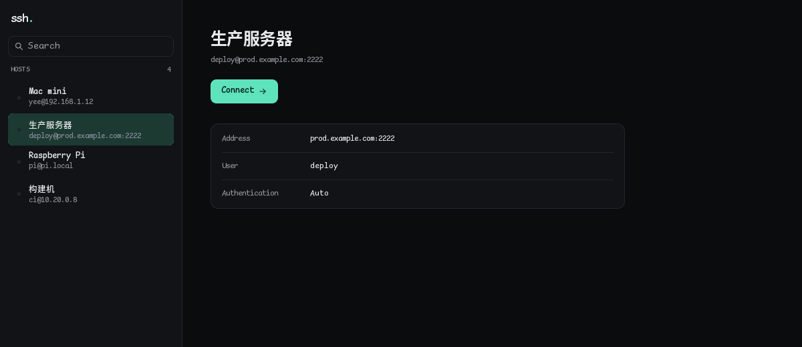

# SSH Desktop

[](https://github.com/akirousnow/ssh-desktop/actions/workflows/ci.yml)

A small, quiet SSH client for the desktop, built with
[MyGo](https://github.com/egoist/mygo)'s native UI and Ghostty's terminal
emulator.



- **Hosts at a glance.** Save servers in a sidebar, search them, and connect
  with a click or Enter. A dot shows whether a host has a live session.
- **Auto authentication.** By default a host tries the SSH agent, then every
  unencrypted key in `~/.ssh`. Pick the agent, a private key, or a password
  when you need to.
- **A real terminal.** Colors, Unicode and emoji, scrollback, selection, copy
  and paste, mouse reporting, bracketed paste and resize. Reconnect or close a
  disconnected session and keep its scrollback.
- **Host keys.** Keys are checked against `~/.ssh/known_hosts`. An unknown key
  asks before it is trusted; a changed key is never accepted silently.
- **Native UI.** It starts instantly, follows the desktop's light or dark
  appearance, and uses the system's sans and monospaced faces for Latin and
  Han text.

## Run

```sh
go run .
```

Package a distributable app with the MyGo CLI:

```sh
go tool mygo build
```

The first terminal start downloads `libghostty-vt` into the user cache; a
packaged app includes it. On Linux, native UI needs GTK 3 and its OpenGL area
(or `MYGO_GPU=0`). Go 1.27.3 or newer is required.

## Authentication

`Auto` tries:

1. the keys of a running ssh-agent (`SSH_AUTH_SOCK`),
2. every key in `~/.ssh` that needs no passphrase, in the order
   `id_ed25519`, `id_ecdsa`, `id_rsa`, `id_dsa`, then the rest by name.

Encrypted keys are skipped by Auto; choose **Private key** to enter their
passphrase. Passwords and passphrases are kept in memory for the session. A
password is written to the config only when **Remember on this device** is
checked, in plain text, in a file only you can read.

## Configuration

- Hosts: `~/.config/SSH Desktop/hosts.json` (mode 0600)
- Host keys: `~/.ssh/known_hosts`, shared with OpenSSH

Nothing but SSH connections leaves this machine.

## Keyboard

| Keys | Action |
|---|---|
| `Ctrl`/`Cmd` + `N` | New host, while a terminal is not focused |
| `Ctrl`/`Cmd` + `K` | Search hosts |
| `Enter` | Connect the host chosen in the list |
| `Cmd` + `C` / `V` | Copy and paste in the terminal on macOS |
| `Ctrl` + `Shift` + `C` / `V` | Copy and paste in the terminal on Linux |

The menu bar hides until you press Alt (Linux and Windows); on macOS it is the
system menu bar.

## Development

```sh
go test ./...
go vet ./...
go tool mygo vet .
```

Views run without a window in tests: `ui.NewTester` clicks and types as a user
would.

## License

MIT
